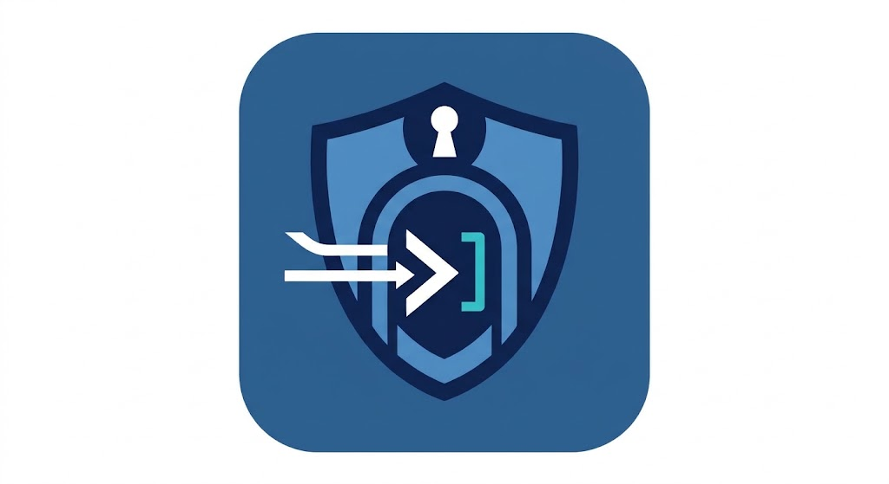

# Security Gate



[](https://github.com/scndr/traefik-security-gate)

A [Traefik](https://traefik.io) middleware plugin that lets a request through
only if it satisfies a configurable list of rules, combined with `anyOf` or
`allOf` logic. Everything else gets a uniform `403 Forbidden`.

Two rule types are available:

| Type     | Passes when…                                                                                |
|----------|---------------------------------------------------------------------------------------------|
| `mtls`   | the request carries a **verified** TLS client certificate, optionally checked against a CRL |
| `header` | a given HTTP header has the expected value                                                  |

The plugin uses only the Go standard library and runs under Traefik's Yaegi
interpreter (Traefik v3, Go 1.22+).

---

## Installation

Add the plugin to your static configuration:

```yaml
experimental:
  plugins:
    securitygate:
      moduleName: github.com/scndr/traefik-security-gate
      version: v0.1.0   # replace with the latest release tag
```

The plugin is published at
[github.com/scndr/traefik-security-gate](https://github.com/scndr/traefik-security-gate).
Check the [Releases](https://github.com/scndr/traefik-security-gate/releases)
page for the latest version tag to use above.

For local development with `localPlugins`, see [Local development](#local-development).

---

## Quick start

Dynamic configuration (file provider):

```yaml
http:
  middlewares:
    gate:
      plugin:
        securitygate:
          mode: anyOf          # a client certificate OR the API key is enough
          rules:
            - type: mtls
              crlFilePath: /certs/crl.pem
            - type: header
              headerName: X-Gate-Key
              headerValue: change-me

  routers:
    app:
      rule: Host(`app.example.com`)
      entryPoints: [websecure]
      middlewares: [gate]
      service: app
      tls:
        options: mtls

tls:
  options:
    mtls:
      clientAuth:
        caFiles:
          - /certs/ca.pem
        clientAuthType: VerifyClientCertIfGiven
```

---

## Configuration reference

### Plugin

| Field   | Default | Description                                                         |
|---------|---------|---------------------------------------------------------------------|
| `mode`  | `anyOf` | `anyOf`: one rule is enough. `allOf`: every rule must pass.         |
| `rules` | –       | List of rules (at least one required).                              |

### Rule `header`

| Field           | Default | Description                                                                                             |
|-----------------|---------|---------------------------------------------------------------------------------------------------------|
| `type`          | –       | Must be `header`.                                                                                       |
| `headerName`    | –       | Header to check (required).                                                                             |
| `headerValue`   | –       | Expected value (required). Plain exact string comparison.                                               |
| `forwardHeader` | `false` | By default the header is **stripped** from the request before it reaches the backend, so the secret never appears in backend logs. Set to `true` to forward it unchanged. |

> The header is stripped from every allowed request, even in `anyOf` mode when
> the request was admitted by a different rule (e.g. `mtls`).

### Rule `mtls`

| Field                               | Default | Description                                                                             |
|-------------------------------------|---------|-----------------------------------------------------------------------------------------|
| `type`                              | –       | Must be `mtls`.                                                                         |
| `crlFilePath`                       | –       | Path to a CRL file (PEM or DER). Without it, no revocation check is performed.          |
| `crlReloadInterval`                 | `60`    | Seconds between checks for a changed CRL file. Must not be negative.                   |
| `insecureAllowUnverifiedClientCert` | `false` | **Insecure.** See below.                                                                |
| `insecureFailOpen`                  | `false` | **Insecure.** See below.                                                                |

---

## Security model

### The mTLS rule requires a verified chain

The `mtls` rule only trusts `req.TLS.VerifiedChains` — certificates that
Traefik has already validated against your CA. Certificates merely *presented*
by the client (`PeerCertificates`) are ignored, because any client can present
a self-signed certificate.

For this to work, the TLS option on the router **must** declare the CA and
require client certificate verification:

| `clientAuthType`              | Effect with this plugin                                                     |
|-------------------------------|-----------------------------------------------------------------------------|
| `RequireAndVerifyClientCert`  | Clients without a valid certificate cannot connect at all                   |
| `VerifyClientCertIfGiven`     | Clients may connect without a certificate (needed to mix `mtls` + `header`) |
| anything else                 | No verified chain is produced: the `mtls` rule always fails (safe)          |

TLS options are selected by SNI — all routers on the same hostname share the
same options.

### `anyOf` is as strong as its weakest rule

With `mode: anyOf`, a static header secret bypasses mTLS entirely. This is
legitimate (mTLS for humans, API key for scripts), but the overall protection
is that of the weakest rule. Use `allOf` when every factor must be present.

### Uniform failures

Denied requests always receive `403 Forbidden` with no hint about which rule
failed.

---

## Certificate revocation (CRL)

- Revoked certificates are identified by **issuer + serial number**, so
  certificates with the same serial from different CAs never collide.
- The file is checked at most once per `crlReloadInterval`, lazily when a
  request arrives — no background goroutine. It is reloaded only when its
  modification time changes. If a reload fails, the last known good CRL
  remains active.
- The CRL signature is **not** verified: the file is trusted because it is
  local to the Traefik host.
- Only the client (leaf) certificate is checked against the CRL, not
  intermediate CAs.

**Default behavior is fail-closed:** if the CRL is missing, unreadable, or
unparsable, every certificate is rejected. A certificate listed in the last
known CRL is always rejected, regardless of the fail-open policy.

### Insecure flags

Both flags are opt-in and log a warning at startup.

- **`insecureFailOpen: true`** — when the CRL is missing or unreadable,
  certificates are accepted instead of rejected. Has no effect without
  `crlFilePath`.
- **`insecureAllowUnverifiedClientCert: true`** — when no verified chain is
  present, the first *presented* certificate is used. That certificate has not
  been validated by anyone, so any client can pass with a self-signed
  certificate. The CRL check still applies. Only use this if trust is
  established somewhere else.

---

## Examples

### mTLS or shared-secret header

Pass if the client has a valid certificate **or** provides the correct API key.

```yaml
mode: anyOf
rules:
  - type: mtls
    crlFilePath: /pki/crl/crl.pem
  - type: header
    headerName: X-Api-Key
    headerValue: supersecret
```

### Require both mTLS and header

```yaml
mode: allOf
rules:
  - type: mtls
  - type: header
    headerName: X-Api-Key
    headerValue: supersecret
```

### mTLS only, no CRL

```yaml
rules:
  - type: mtls
```

### Header only

```yaml
rules:
  - type: header
    headerName: X-Secret
    headerValue: mysecret
```

### mTLS with fail-open

Accept connections even if the CRL file becomes temporarily unavailable
(useful during CRL rotation):

```yaml
rules:
  - type: mtls
    crlFilePath: /pki/crl/crl.pem
    insecureFailOpen: true
```

---

## IP allowlisting

IP-based access control is intentionally not included. Use Traefik's built-in
[`ipAllowList`](https://doc.traefik.io/traefik/middlewares/http/ipallowolist/)
middleware and chain it with SecurityGate:

```yaml
http:
  middlewares:
    lan-only:
      ipAllowList:
        sourceRange:
          - "192.168.0.0/16"
          - "10.0.0.0/8"

  routers:
    my-router:
      middlewares:
        - lan-only
        - my-gate
```

---

## Logging

The plugin logs through the standard logger, prefixed with
`securitygate[<middleware name>]`:

- CRL load results and errors
- Every blocked revoked certificate
- CRL state transitions (problem detected / healthy again), not one line per request
- A warning at startup for each enabled `insecure*` flag

---

## Local development

```bash
# clone
git clone https://github.com/scndr/traefik-security-gate.git
cd traefik-security-gate

# build
go build ./...

# vet
go vet ./...

# run all tests
go test ./...

# verbose output
go test -v ./...

# run a specific test
go test -run TestMTLS ./...

# race detector
go test -race ./...

# lint (requires golangci-lint)
golangci-lint run
```

Static configuration for local plugin loading:

```yaml
experimental:
  localPlugins:
    securitygate:
      moduleName: github.com/scndr/traefik-security-gate
```
